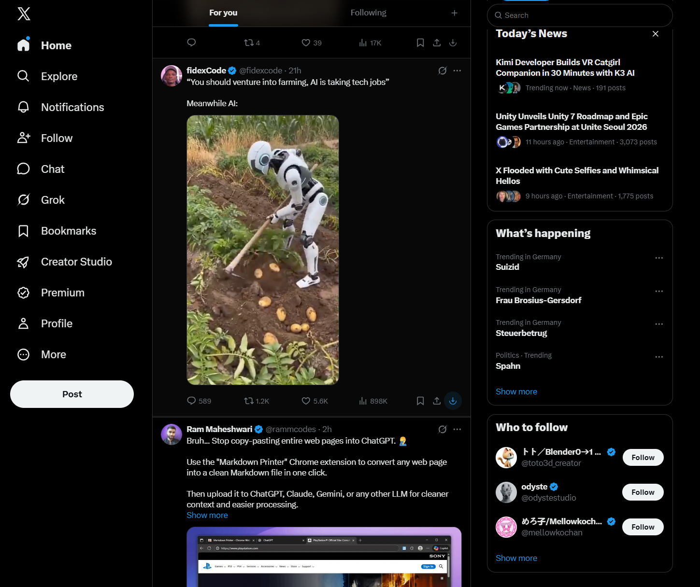

# X Downloader – Save, Local Bonsai 2 Translate & Copy Image

Save any video or GIF, translate posts locally with **Ternary Bonsai 2 4B**, and copy high-res images straight to your clipboard on **X (formerly Twitter)** — all from clean, native-looking controls injected directly into X's UI with zero ads, zero tracking, and zero cloud API keys.




> **One-click video/GIF saving, on-demand local AI translation, and hover image copying** — seamlessly integrated into X's timeline, replies, quoted tweets, and focal `/status/...` pages.

---

## 🆕 What's New in v1.5

- **Local AI Post Translation (`Bonsai 2 · 4B Q2_0`)** — a **Translate** button sits immediately to the left of **Save** (and on text/photo posts), translating from any language (Japanese, Chinese, Korean, English, etc.) into **Russian** by default, or **EN / DE / ES / FR / ZH / JA / KO / TR**.
- **Strict On-Demand VRAM Lifecycle (`0 MB` at idle)** — a tiny Go bridge (`127.0.0.1:18791` via macOS `LaunchAgent`) keeps `llama-server` completely unloaded until you click **Translate**, loads `Ternary-Bonsai-2-4B-Q2_0.gguf` into Metal VRAM (`-ngl 999 -fa on --cache-reuse 64 --reasoning off`), keeps it warm for **150s (2.5 min)**, and automatically unloads it when idle.
- **Full Hidden `"Show more"` Post Support** — `interceptor.js` extracts complete untruncated `note_tweet` / `legacy.full_text` payloads directly from X's GraphQL responses and React Fiber (with syndication fallback), so long posts hidden behind **Show more** are translated completely.
- **Smooth Character Morphing & Native Header Badge** — post text morphs smoothly frame-by-frame via `requestAnimationFrame` while preserving `@mentions`, `#hashtags`, emojis, and clickable URLs. The **Original ↔ Translation** toggle sits inline right beside X's native `Translated from … Show original` bar (or directly above the post).
- **Hover Copy-Image Button** — hovering over any post image (`pbs.twimg.com/media/`) reveals a frosted mini-button in the bottom-right corner (`30×30px`) that upgrades the URL (`name=large`), converts to lossless `image/png`, and copies to clipboard without opening the photo lightbox.
- **Redesigned Popup & Live Memory Telemetry** — dark rounded UI (`v1.5`) with switches for **Save**, **Translate**, and **Copy Image**, target language selector, visual memory bar, live **Loaded by model** vs **Free / Total macOS RAM** (`sysctl` / `vm_stat` / `ioreg`), idle countdown timer, and one-click **Unload**.
- **Pixel-Accurate Layout & Hot-Reload** — properly centered and evenly spaced in both timeline/reply bars and `48px` focal `/status/...` action bars (`.r-h3s6tt`), plus automatic re-injection into already-open X tabs when reloading the extension (`chrome.scripting`).

---

## ✨ Features

- **One-click video & GIF downloads** — grabs the highest-bitrate MP4 stream from X's GraphQL `video_info` or direct `<source>`, saving cleanly as `x_<author>_<tweetID>.mp4` (`_gif` suffix for GIFs).
- **Local line-preserving translation** — translates paragraph-by-paragraph with `stop: ["\n"]` and KV-cache reuse, preserving paragraph breaks and preventing model rambling or truncation. Pure Russian posts (when targeting `RU`) skip inference without waking VRAM.
- **Clipboard image copy on hover** — copies post photos directly as PNG into the system clipboard (excluded on video/GIF players so it never overlaps mute controls).
- **Zero React breakage** — hides original `[data-testid="tweetText"]` via CSS rather than mutating React-managed children, keeping X's virtualized timeline stable.
- **Private by design** — everything runs locally on your machine. No analytics, no telemetry, no remote translation servers.

---

## 🚀 Installation

### 1. Load the Chrome Extension (Unpacked)

1. Clone or download this repository.
2. Open Chrome (or Edge / Brave / Arc) and navigate to `chrome://extensions`.
3. Enable **Developer mode** in the top-right corner.
4. Click **Load unpacked** and select the `x-downloader` folder (containing `manifest.json`).

### 2. Install the Local Bonsai 2 Bridge (macOS)

The local Go bridge discovers `llama-server` and `Ternary-Bonsai-2-4B-Q2_0.gguf` automatically from `~/rugrab-mac-packs/` or `~/Library/Application Support/RuGrab/Models/` (or `XVD_LLAMA_SERVER` / `XVD_MODEL_PATH`):

```bash
./bridge/install.sh
```

This builds `~/.x-downloader/xvd-translate-bridge` and installs the `local.x-downloader.translate` macOS `LaunchAgent` listening on `127.0.0.1:18791`. Idle VRAM stays at **0 MB** until your first translation click.

---

## 🎬 How to Use

| Action | Where | Result |
|--------|-------|--------|
| **Translate** | Icon left of Save (or on text posts) | Loads Bonsai 2 4B on demand, morphs post text smoothly, adds `Original ↔ Translation` header toggle |
| **Save** | Far right in video/GIF action bar | Green flash = MP4 download started; red flash = link not ready (refresh tab) |
| **Copy Image** | Hover bottom-right of any post photo | Upgrades to `name=large`, copies lossless PNG to clipboard, flashes checkmark |

---

## ⚙️ Popup Settings (`v1.5`)

Click the **X Downloader** icon in the browser toolbar:

- **Кнопка скачивания** — show/hide the Save button on video and GIF posts.
- **Кнопка автоперевода** — show/hide the Translate button.
- **Копирование картинок** — show/hide the hover Copy Image mini-button on photos.
- **Язык перевода** — choose target language (`Русский` default, `English`, `Deutsch`, `Español`, `Français`, `中文 (简体)`, `日本語`, `한국어`, `Türkçe`).
- **Bonsai 2 · 4B Telemetry Card** — shows live model state (`Выгружена` / `Загрузка…` / `⏱ M:SS`), visual memory bar, VRAM used by model, free/total system memory, and an instant **Выгрузить** button.

---

## 🔒 Privacy & Permissions

| Permission / Host | Why it's needed |
|-------------------|-----------------|
| `downloads` | Save MP4 videos and GIFs to your Downloads folder |
| `storage` | Persist toggle states and selected target language |
| `scripting` | Hot-inject updated scripts into already-open X tabs on extension reload |
| `x.com` / `twitter.com` | Inject action controls and hot-reload content/interceptor scripts |
| `video.twimg.com` | Fetch the video/GIF stream when you click Save |
| `pbs.twimg.com` | Fetch high-resolution post images when you click Copy Image |
| `cdn.syndication.twimg.com` | Fallback resolver for video URLs or truncated tweet text |
| `127.0.0.1` | Talk to your local `xvd-translate-bridge` (`Origin`-guarded to `chrome-extension://`) |

---

## 📁 Project Structure

| File | Role |
|------|------|
| `manifest.json` | MV3 manifest (`v1.5.0`) — permissions, host access, and world scripts |
| `interceptor.js` | MAIN world — intercepts X GraphQL APIs (`video_info`, `note_tweet`, `full_text`) & React Fiber text lookup |
| `content.js` | Isolated world — injects aligned action slots, hover image copy, character morphing, and `Original ↔ Translation` toggle |
| `content.css` | Styles for `.xvd-action-slot`, `.r-h3s6tt` focal bar alignment, `.xvd-copy-img-btn`, `.xvd-tr-bar`, and `.xvd-tr-inline-chip` |
| `background.js` | Service worker — `chrome.downloads`, syndication fallback, image data-URL fallback, local bridge proxy, and tab hot-reload |
| `popup.html` · `popup.js` · `popup.css` | Dark `v1.5` popup with toggles, target language selector, and live macOS RAM/VRAM telemetry |
| `bridge/main.go` | Go HTTP bridge (`127.0.0.1:18791`) managing on-demand `llama-server` lifecycle, `150s` idle unload, and macOS memory telemetry |
| `bridge/main_test.go` | Go unit & lifecycle tests (language routing, URL protection, cleanup, Origin guard, mock auto-unload) |
| `bridge/install.sh` | Builds the Go bridge and registers the macOS `LaunchAgent` |

---

## ⚠️ Disclaimer

For **personal use only**. Please respect creators' rights and X's Terms of Service — only download or copy content you have the right to use.
